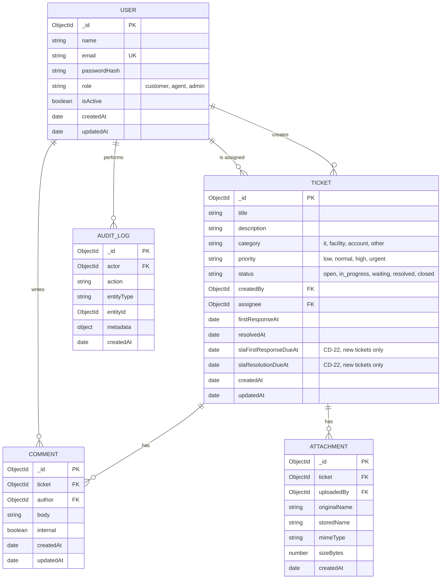

# ClinicDesk data model

## Rules
- `passwordHash` is never returned by the API.
- Audit logs are append-only.
- Status changes follow the transition table in the API contract.
- Internal comments are never returned to customers (see `docs/comments.md`).