# Responsive layout (CD-36)

Screenshots of the main screens at 360px (phone), 768px (tablet) and 1280px (desktop).
The breakpoints and rules are in
[`docs/design-tokens.md`](../design-tokens.md#breakpoints-and-responsive-rules).

The ticket list and detail are shown as an agent, with the filters `status=open` and
`q=printer` set (so "Clear filters" is visible). The data is sample data, not real tickets.

## How these were made

The built client (`npm run build`) was served together with a mocked API that returned a
fixed set of tickets and comments, with a test session in `sessionStorage`. Each screen was
captured with headless Firefox (`firefox --headless --window-size=W,H --screenshot`). The
same run checked that `document.documentElement.scrollWidth` equals the viewport width on
every screen (no horizontal page scroll).

To check by hand: open the app in a desktop browser, open the developer tools' responsive
mode and set the width to 360, 768 and 1280. Then go back to full width, set the browser
zoom to 200%, and repeat with a larger default font size.

## Login

| 360px | 768px | 1280px |
|---|---|---|
| 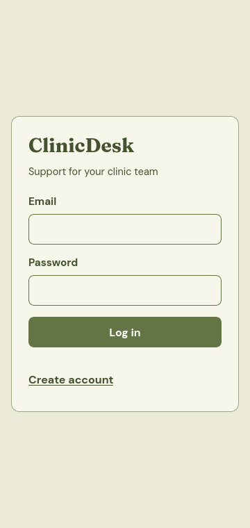 | 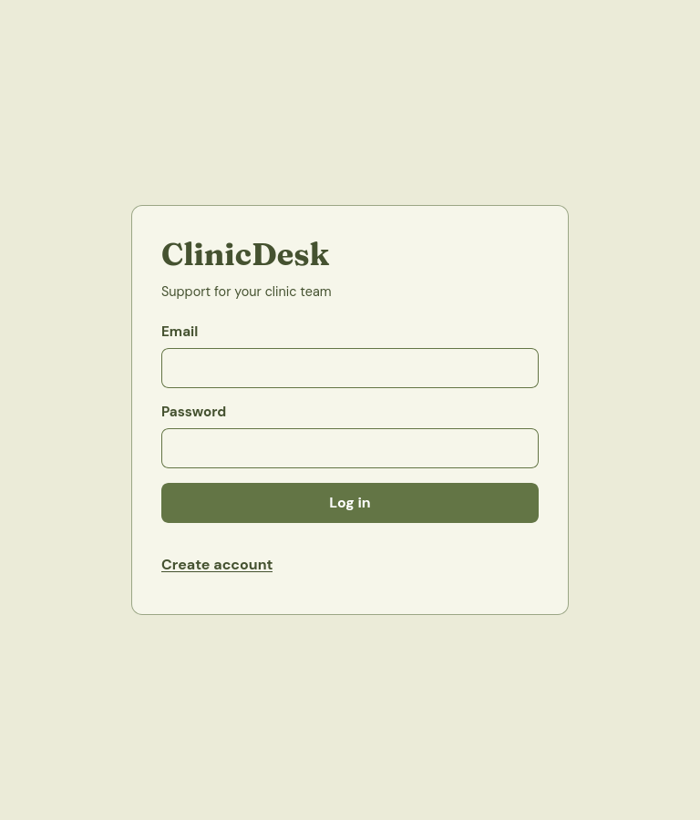 | 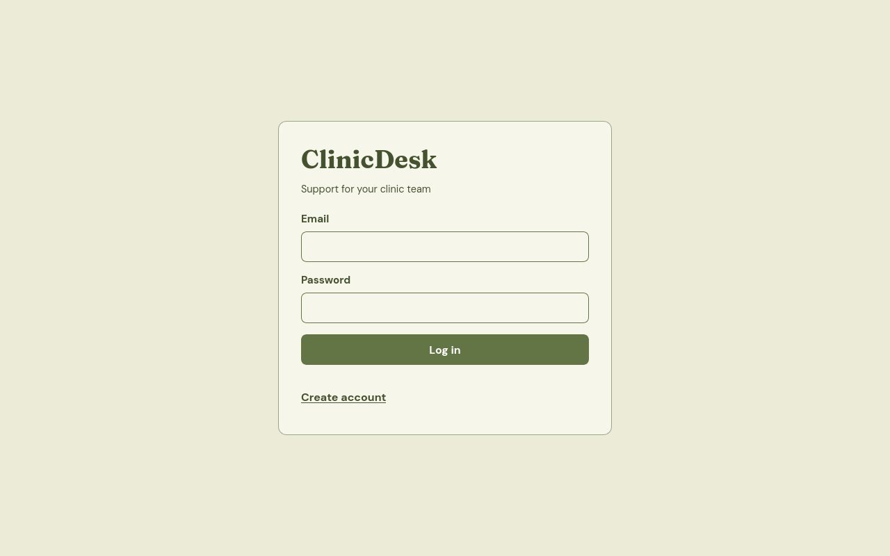 |

## Ticket list with filters

Below 640px each ticket is a card (title, status and priority, assignee, created date),
and the "Sort by" select replaces the sortable column headers. From 640px it is a table.
The filters are in one column on phones, two columns on tablets and one row on desktop.

| 360px | 768px | 1280px |
|---|---|---|
| 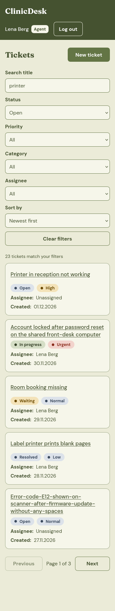 | 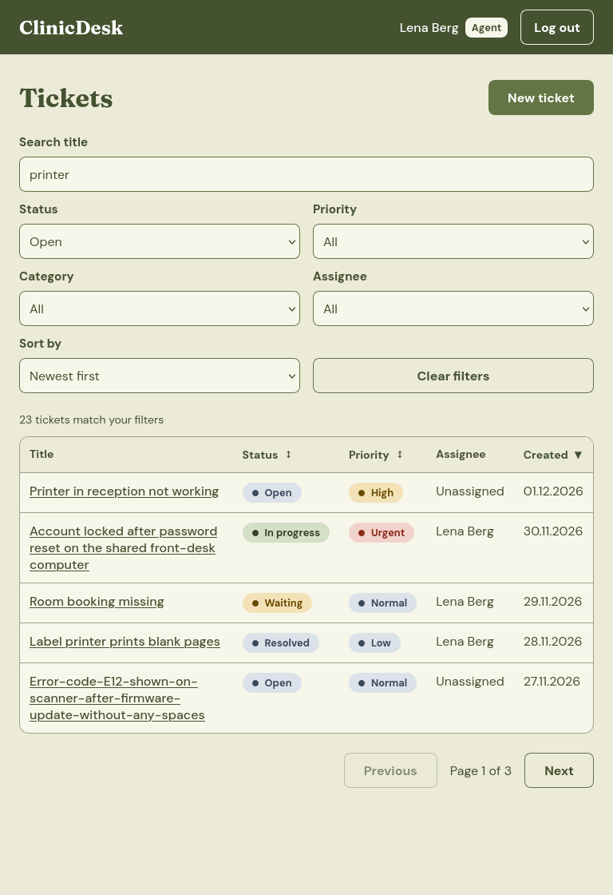 | 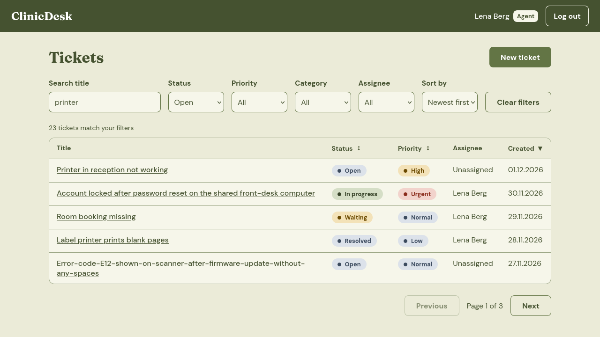 |

## Ticket detail

Status control, assignment, metadata, description with a long URL, and the comment
thread with an internal note and an unbroken word.

| 360px | 768px | 1280px |
|---|---|---|
| 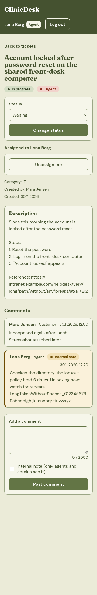 | 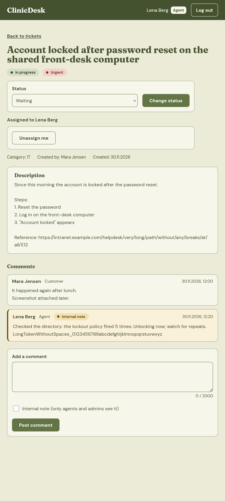 | 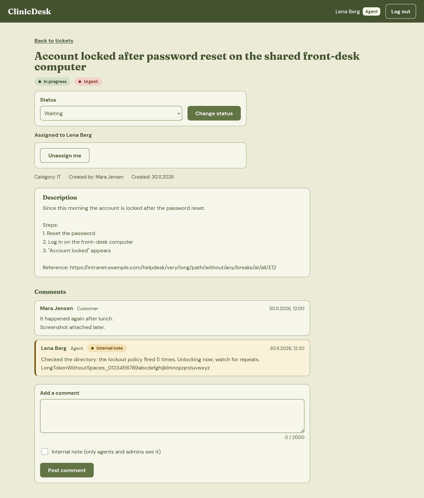 |

## Create ticket

| 360px | 768px | 1280px |
|---|---|---|
| 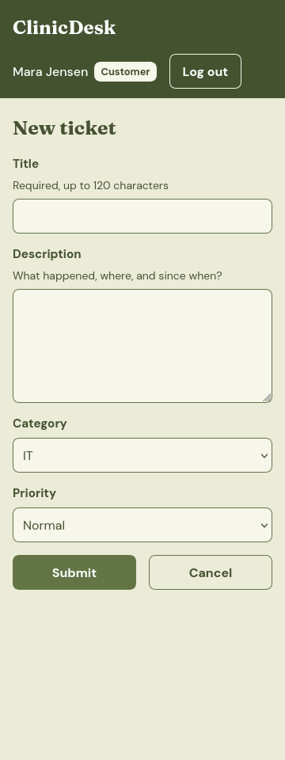 | 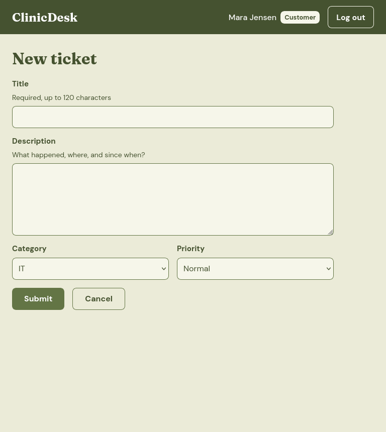 | 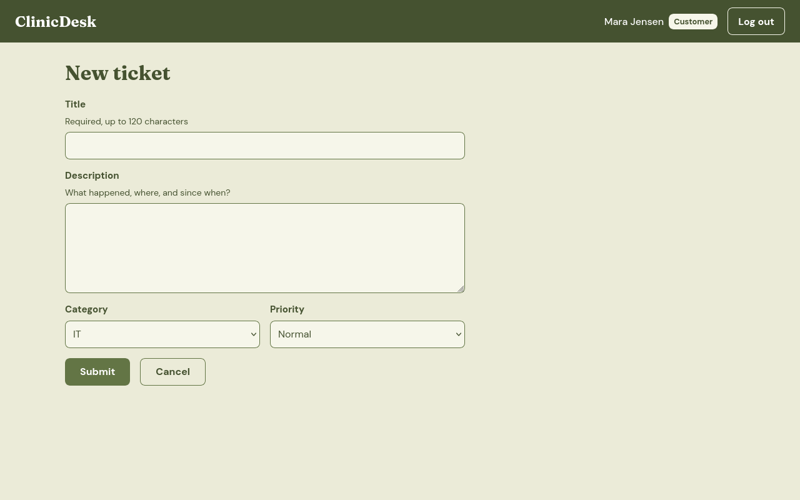 |

## Zoom and large text

| 1280px at 200% zoom (a 640px viewport) | 360px with the default text size doubled (32px) |
|---|---|
| 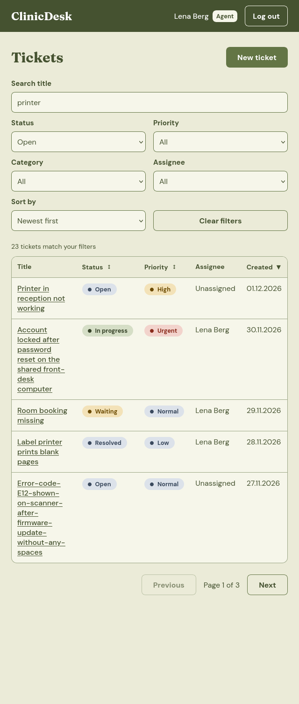 | 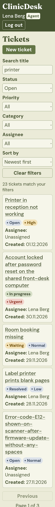 |
