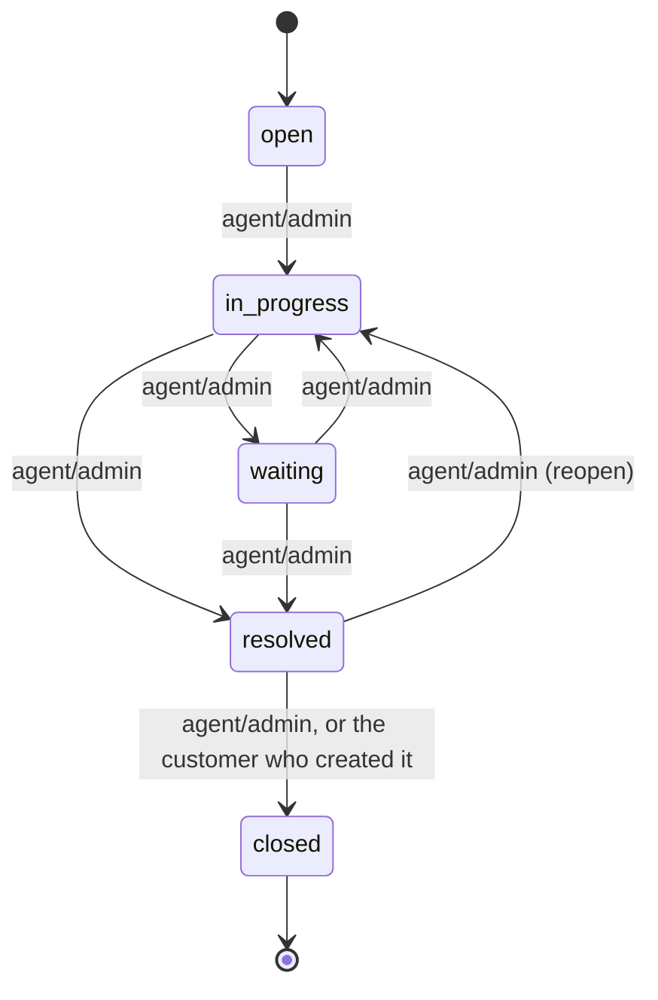

# Ticket status workflow

Rules live in [`server/src/tickets/statusWorkflow.js`](../server/src/tickets/statusWorkflow.js)
and are enforced by `PATCH /api/v1/tickets/{id}/status` (see [`openapi.yaml`](openapi.yaml)).

| From | To | Agent / Admin | Customer (own ticket) |
|---|---|---|---|
| Open | In progress | Yes | No (403) |
| In progress | Waiting, Resolved | Yes | No (403) |
| Waiting | In progress, Resolved | Yes | No (403) |
| Resolved | Closed | Yes | Yes |
| Resolved | In progress (reopen) | Yes | No (403) |
| Closed | anything | No (409) | No (409) |

## Responses

- **404 NOT_FOUND**: invalid id, unknown ticket, or another customer's ticket (same body
  as the detail route, so a ticket's existence is never revealed).
- **400 VALIDATION_ERROR**: missing or unknown `status` value.
- **403 FORBIDDEN**: a customer asks for a change that exists in the workflow but is
  reserved for agents and admins.
- **409 INVALID_TRANSITION**: the change is not in the workflow at all: skipping steps
  (open → resolved), going backwards (waiting → open), setting the same status again,
  or anything from closed.
- **409 STATUS_CONFLICT**: someone else changed the status between reading and saving.
  The update uses the expected current status as a condition, so it is never applied
  on top of a newer status.

## Side effects

- Moving to **resolved** sets `resolvedAt`; **resolved → in progress** clears it; closing
  keeps it.
- `firstResponseAt` is not changed by status updates; the first agent comment sets it
  (CD-14).

## In the client

`GET /tickets/{id}` and the PATCH response include `allowedNextStatuses` for the current
user, so the UI offers only valid choices without repeating these rules.
