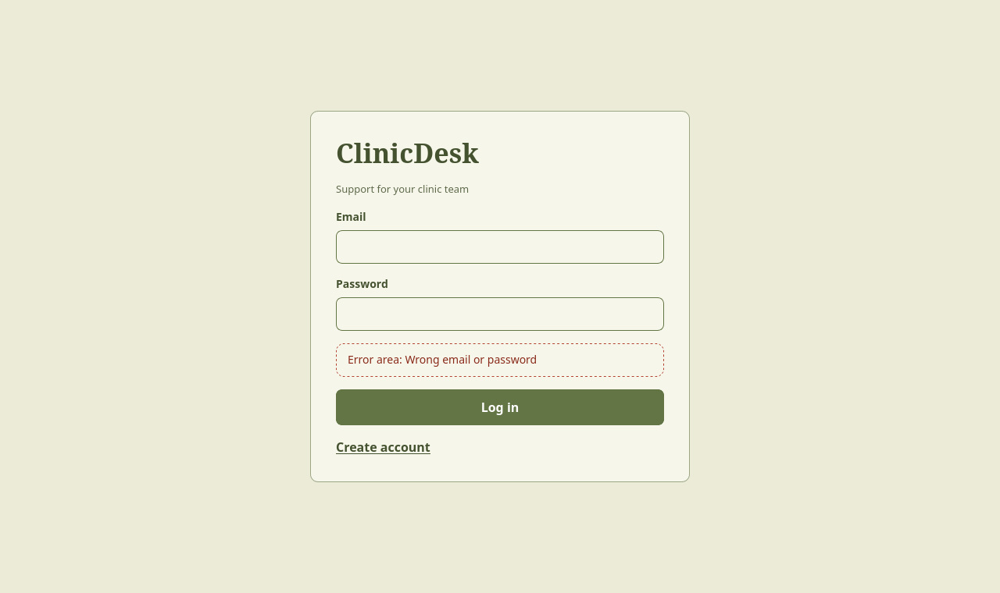
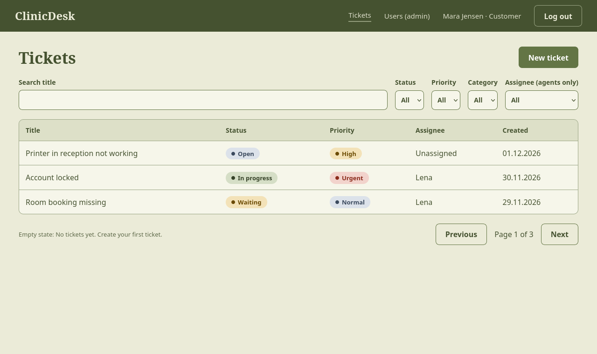
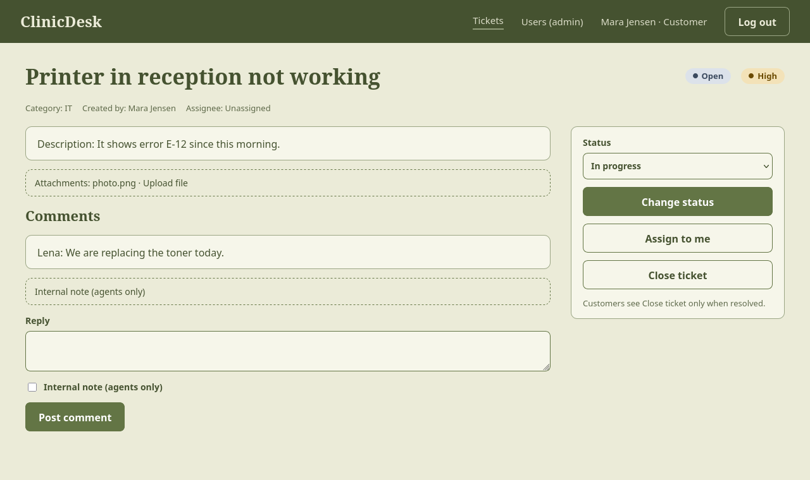
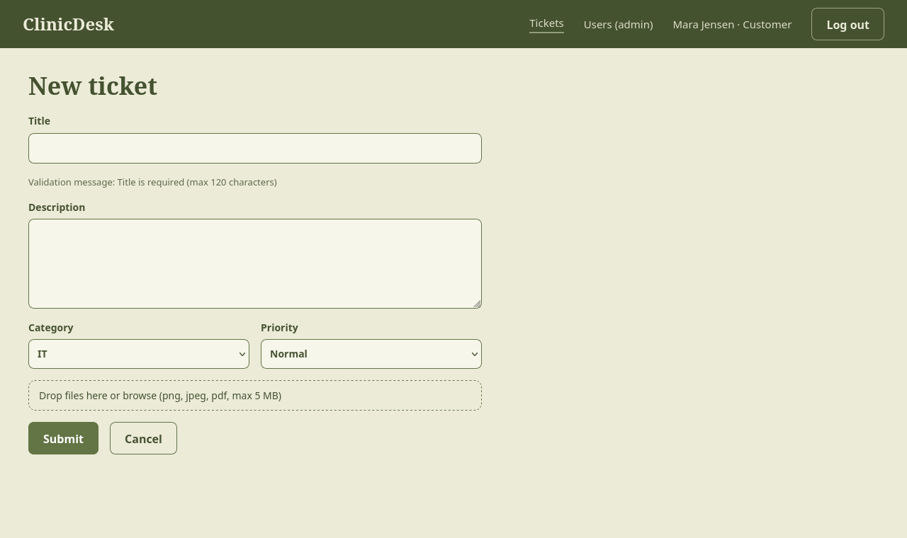
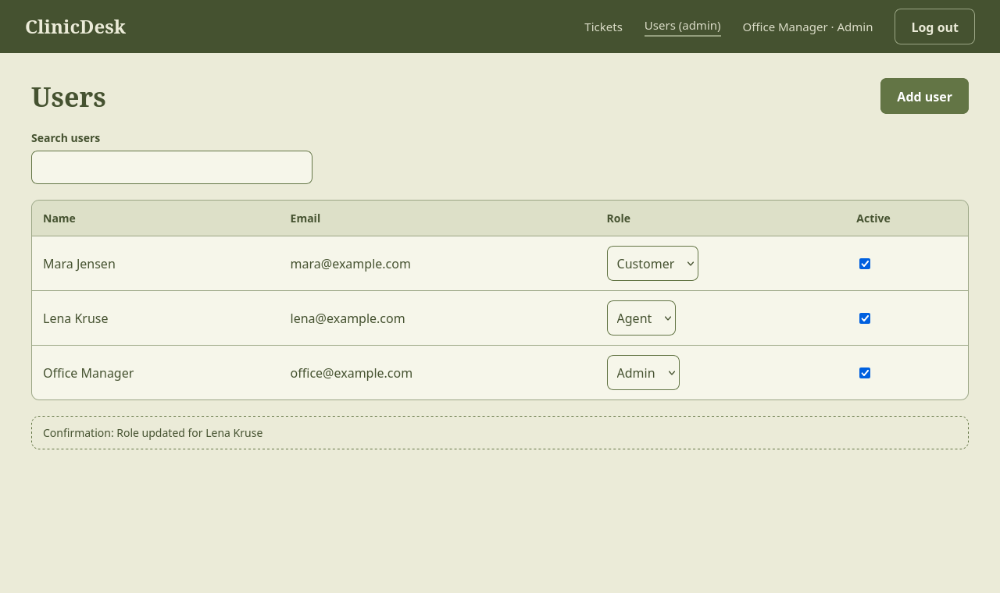
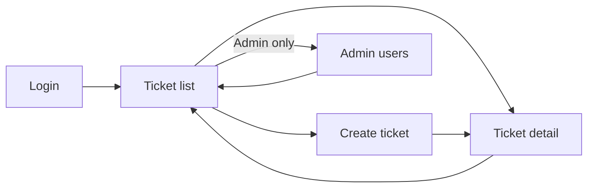

# Wireframes

Low-fidelity wireframes for the first release. The interactive canvas is here:
[ClinicDesk wireframe canvas](https://claude.ai/artifact/Gh4joQGdCpDHNMFHfz2aLM).

Visual styling follows [`docs/design-tokens.md`](../design-tokens.md).

The PNGs below are exported at 1280×760 and render headings in a fallback serif;
the design itself uses Fraunces for headings (and DM Sans for body text).

## Screens

### 1. Login

Email and password form with an error area, a primary Log in button and a link to create an account.

### 2. Ticket list

Tickets table with status and priority badges, search and filters, pagination and an empty state.

### 3. Ticket detail

Description, attachments, comments and agent-only internal notes, with a side panel to change status, assign or close.

### 4. Create ticket

Title, description, category, priority and file upload, with inline validation and Submit or Cancel.

### 5. Admin users

User table where admins search users, add users, change roles and set accounts active or inactive.

## Screen flow

